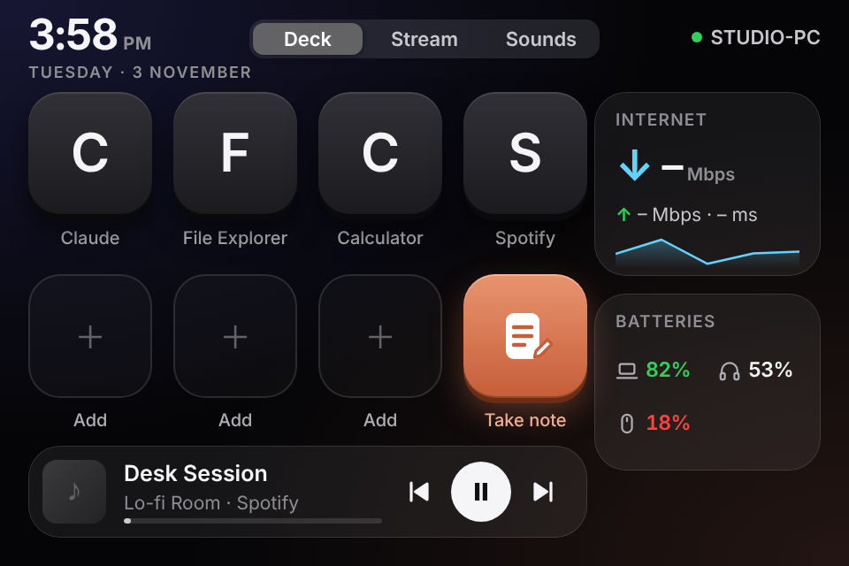
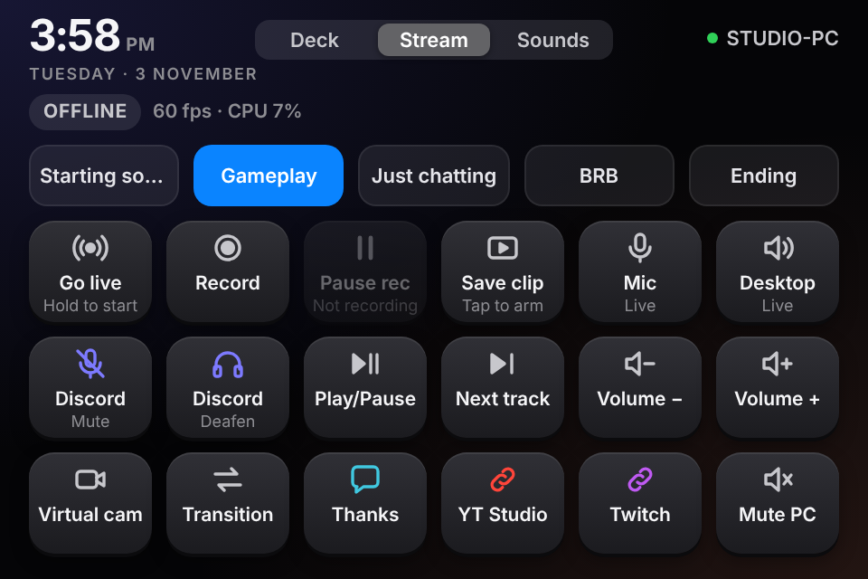
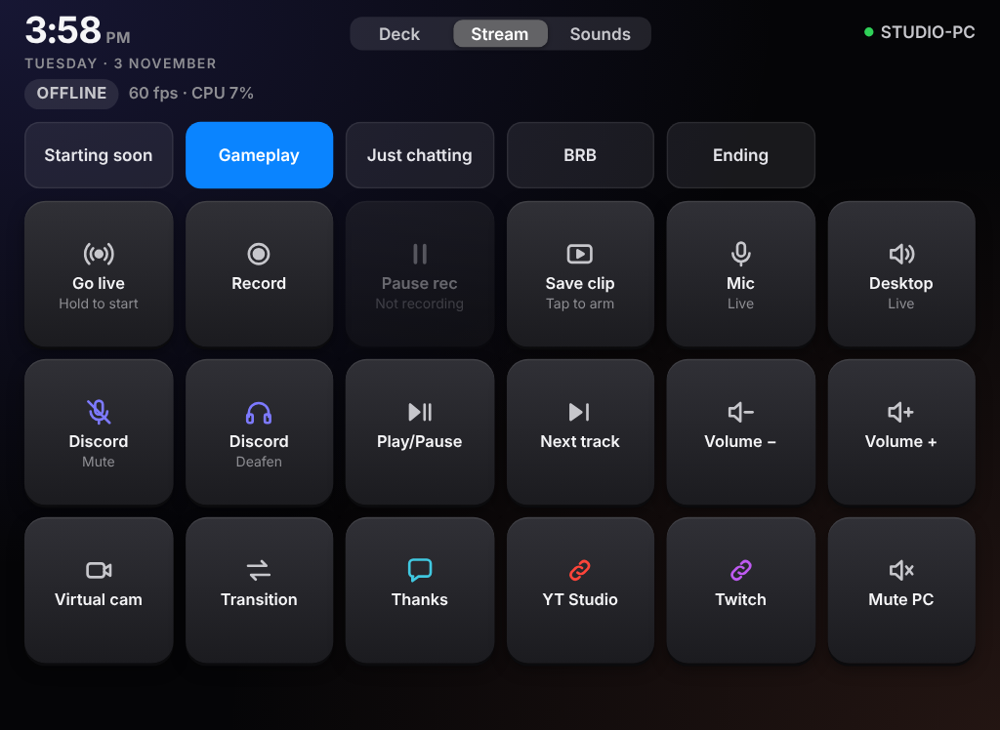

# Thirai

Thirai (திரை, Tamil for "screen") turns an old phone or tablet into a touch control panel for your PC or Mac. It has app keys, now playing, internet and battery widgets, and streaming controls for OBS, Discord and music, plus a soundboard.

Nothing is installed on the phone. The panel is a web page, so it runs in Safari or Chrome on anything from an iPhone 4S or iPad 2 to the latest Android tablet.

| Deck | Stream |
| --- | --- |
|  |  |

On a tablet you get more keys and bigger buttons:



## What it does

The Deck page has 7 app keys on a phone and 14 or 17 on a tablet, plus Take note, which turns a note into a new chat in the Claude desktop app. It also shows what's playing with track controls, your internet speed, and laptop and Bluetooth battery levels.

The Stream page (Windows) has a button for each OBS scene and buttons to go live, record, pause, save a replay clip, switch the virtual camera, transition in studio mode, and mute the mic or desktop audio. Discord mute and deafen, media and volume keys, canned chat messages and links sit alongside. Going live needs a press and hold. The top line shows live and recording timers, frame rate, CPU and dropped frames, and every button is set in one config file.

The Sounds page (Windows) turns any `.mp3` or `.wav` in the sounds folder into a button. Sounds play through your speakers, so OBS picks them up.

An Android phone can also run over a USB cable, with the PC closed to Wi-Fi entirely.

## Quick start on Windows

1. Download `windows/dist/thirai-windows-x64.exe` (`arm64` for Snapdragon laptops) and double-click it.
2. Allow it on Private networks when Windows Firewall asks.
3. Open the link it prints on your phone, then add it to the home screen.
4. Hold any key to pick your apps.

To use a USB cable with an Android phone instead, run `start-usb.bat`. To connect OBS and Discord, follow the [guide](docs/GUIDE.md#connect-obs-once).

## Quick start on a Mac

```bash
git clone https://github.com/<you>/thirai.git
cd thirai
swift build -c release
.build/release/thirai
```

Then open the printed link on the phone. The full Mac setup, including the camera and mic tab for modern iPhones, is in [docs/MAC.md](docs/MAC.md).

## Docs

- [Guide](docs/GUIDE.md): Windows setup, Stream and Sounds pages, button config, wired mode, Android and tablets, security notes
- [Mac](docs/MAC.md): Mac server setup, permissions, HTTPS for modern iPhones, troubleshooting

## Security in one paragraph

Every request needs a random access token, and the phone can only press buttons you've configured. On Wi-Fi the link travels as plain HTTP, so treat it like a password and use it on your home network only. Wired mode avoids the network altogether. Never port-forward Thirai to the internet. Details are in the [guide](docs/GUIDE.md#security-notes).

## Credits

Thirai is built by Merrilin A J on [OldPhoneDeck](https://github.com/GLAUCOMA82/OldPhoneDeck) by GLAUCOMA82 (MIT licence). The phone page and the Mac server come from that project. The Windows server, Android and tablet support, wired mode, Stream and Sounds pages and the security changes are new in Thirai. Both were built with [Claude Code](https://claude.com/claude-code).

## Licence

[MIT](LICENSE)
